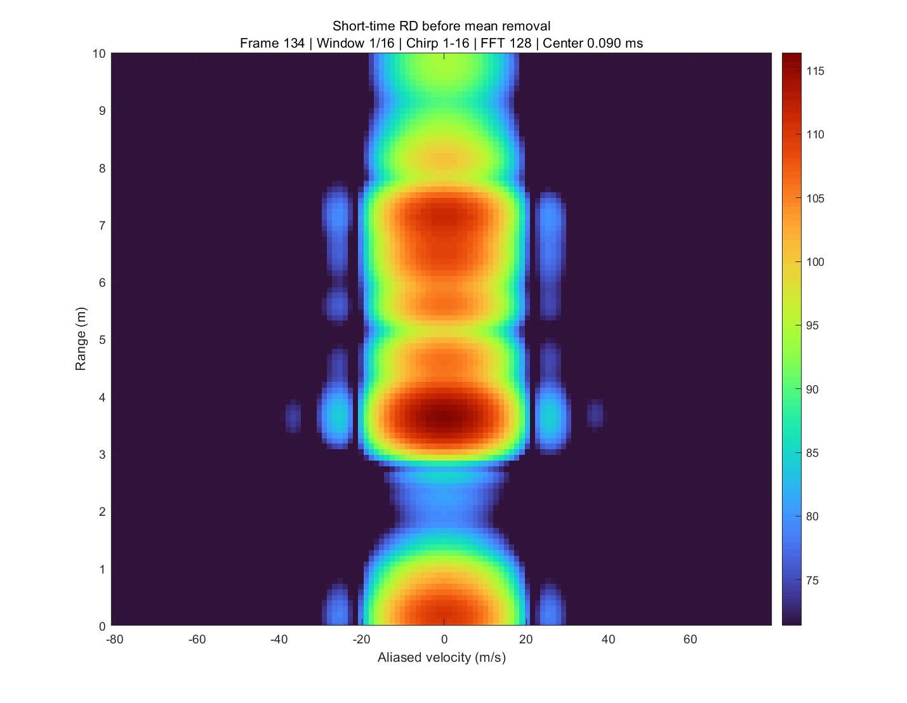
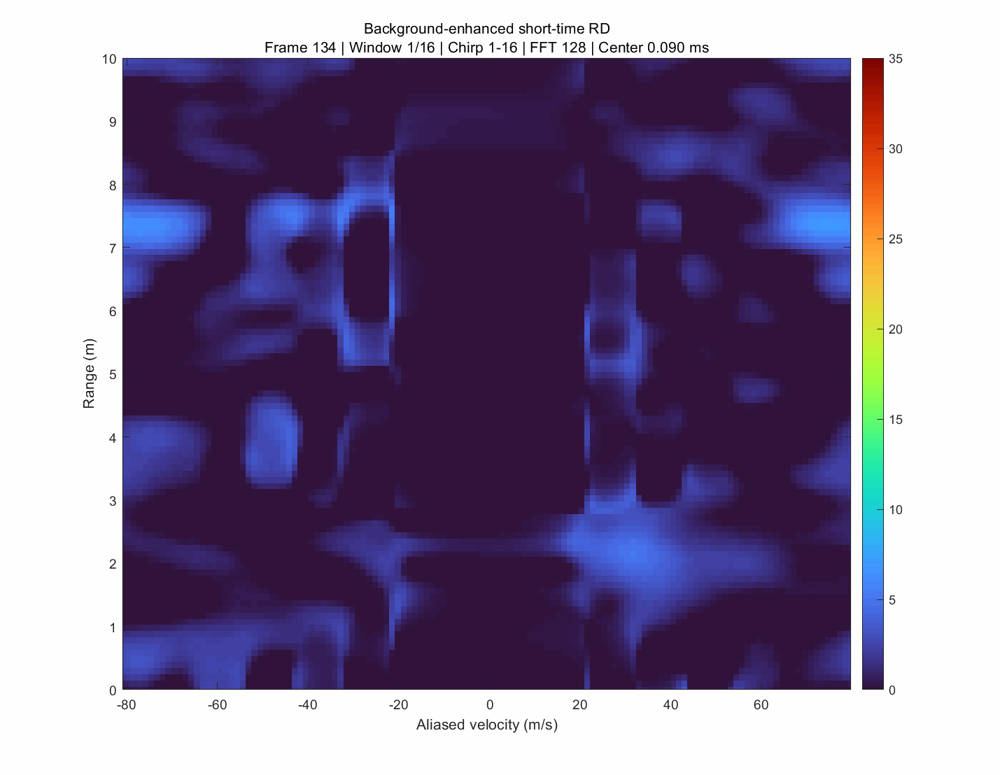

# 高速弹丸毫米波雷达数据采集与分析

面向 **AWR2243-2X-CAS-EVM + AM2732R + DCA1000** 实测数据的 MATLAB 工程，包含上位机手动采集、全文件浏览、选定帧精细检测，以及脚本化离线分析。

> 本文描述 `feature/uppermachine-data-processing-v1` 功能分支。两个界面分别负责“整体查看与选帧”和“精细目标检测与几何测速”。当前交付形式是 MATLAB 源码工程，不是已打包的独立安装程序。

## 快速运行

第一次获取工程：

```bash
git clone --branch feature/uppermachine-data-processing-v1 https://github.com/ZHANGCQ2001/projectile-radar-analysis.git
cd projectile-radar-analysis
```

已有本地仓库时，先保存本地改动并关闭旧 App，再更新：

```bash
git switch feature/uppermachine-data-processing-v1
git pull --ff-only
```

在 MATLAB 中进入**包含 `startup.m` 的项目根目录**，执行：

```matlab
cd('D:\projectile-radar-analysis')  % 替换为本机实际路径
startup
app = RadarControlMachineApp;
```

`startup` 添加 `src`、`configs`、`scripts`、`examples`、`tests` 和 `uppermachine`。不要只复制主界面 `.m` 文件，也不要把旧版补丁包当成完整工程。下载 ZIP 时同样需要选择上述功能分支。

### 运行环境与依赖

| 用途 | 条件与边界 |
|---|---|
| 界面1离线浏览 | MATLAB；Signal Processing Toolbox（当前 RD 路径调用 `medfilt1`、`hann`）；无需接雷达 |
| 界面2与公共算法 | MATLAB 的数组、FFT、table、`polyfit`、`fminsearch` 等；界面2使用 `pradar.processWindow`，不是复制界面1的处理链 |
| 手动采集 | Windows、完整 TI CLI 配套文件、正确设备连接与网络配置；见[采集说明](docs/acquisition.md) |
| 研究脚本 | 按各脚本的数据与工具箱依赖运行；STFT/FSST 不属于启动主界面的必经步骤 |
| 验证范围 | 已有 MATLAB R2025b / Ubuntu 24.04 离线回归记录；不等于已确定最低 MATLAB 版本或通过 Windows 接板验收 |

**离线启动也会初始化路径和运行时 JSON。** 保留 `uppermachine/third_party/ti_postproc/AM273X_Capture.json`；CLI 目录及当前默认数据目录 `C:\CaptureData` 应可写。启动时不需要点击“配置FPGA”或“开始采集”。

## 两个界面的使用流程

```text
已有 BIN 文件
  → 界面1：加载文件，整体浏览 RD / ADC / 1D FFT
  → 查看“每帧最大 SNR”，确定目标物理帧范围
  → 填写目标起始帧、目标终止帧
  → 点击“界面2：精细处理”
  → 确认纯背景帧、目标帧、真实帧周期
  → 输入横向距离、接近/远离方向、沿轨迹参考速率
  → 开始处理，核查候选、轨迹与速度
  → 导出 MAT / CSV / 摘要
```

### 界面1：整体查看与选帧

保留手动采集、原始 ADC、1D FFT、频点 RD、物理坐标 RD 和最大 SNR 趋势。旧单点解模糊、距离/速度拟合趋势功能已删除。

最大 SNR 趋势横轴是**当前 BIN 内从 1 开始的物理帧号**；纵轴是该帧所有有效滑窗中最大的 SNR 指标，不再绘制最大 SNR 点的距离和速度趋势。当前帧只保留一条标度线，换文件或修改参数使缓存失效时会清除旧标记。无有效值的帧保留 `NaN`。

**两种 RD 图都固定执行当前滑窗内的慢时间去均值**，没有新增开关：

```matlab
adcOutFrame = adcOutFrame - mean(adcOutFrame, 2);
```

这里第 2 维是 Chirp。界面1的“原始 ADC”显示和“1D FFT”使用其他读取/显示路径，不能据此说所有视图都使用同样的预处理。

### 界面2：精细检测与几何测速

处理链为：短时 RD → 背景功率中值建模 → 背景增强 → 多候选提取 → 几何轨迹关联与拟合 → 逐点径向速度解模糊及沿轨迹速率折算。

输入横向距离 `d` 是**雷达到直线运动轨迹的最短距离**。每个目标点使用自己的雷达—目标斜距 `R_i`，而不是整段共用一个距离或角度：

```text
c_i = radialDirection * sqrt(R_i^2 - d^2) / R_i
v_r,i(k) = v_alias,i + 2*k*Vmax
V_i(k) = v_r,i(k) / c_i
```

径向候选先枚举，再按该点投影折算为沿轨迹速率候选；全局动态规划以目标运动结束帧的参考速率为锚点，向起始帧逆向选解，并用相邻帧连续性与模糊数跳变惩罚约束。速率范围和参考速率均为正值，运动方向单独选择。距离拟合使用 `R(t)=sqrt(d^2+(x0+V*t)^2)`，估计非零初始位置。

`R_i<=d` 或投影过小的点不会强行折算；跨越最近点的轨迹要分成接近段和远离段处理。几何参数和参考速率必须按实验确认，默认 `d=0`、参考速率 `400 m/s` 不是实测结果。完整操作见[双界面说明](docs/uppermachine_processing.md)和[几何拟合说明](docs/track_fitting.md)。

## 最容易混淆的设置和指标

| 项目 | 界面1 | 界面2（从界面1首次打开） |
|---|---|---|
| 默认滑窗/步进 | 256 / 256 Chirp | 16 / 16 Chirp；可单独修改 |
| Doppler FFT | 长度等于当前滑窗长度 | 初始 128 点；不等于实际相干 Chirp 数 |
| 慢时间去均值 | 固定开启 | 独立勾选框，首次默认关闭 |
| 选帧指标 | 当前 RD 对数幅度与局部训练单元均值之差，界面称 SNR | 所选目标功率 / 所选背景功率的 dB 增强量 |
| 距离/速度用途 | 浏览和定位数据区间 | 候选关联、几何拟合、解模糊、导出 |

`pradar.defaultConfig()` 的慢时间去均值默认为 `true`，但 `radarui.buildProcessingConfig()` 为界面2设为 `false`。不要把其中一个入口的默认值当成所有入口的设置。

两种 dB 指标**不是同一个量，也都不能直接当作经标定的热噪声 SNR 或绝对 RCS**。SNR 高峰是选帧线索，不是弹丸已被确认的证明。详见[算法说明](docs/algorithm.md)。

## 无硬件样本验证

仓库包含 `data/123207_frames_126_135.bin`：10 个物理帧，默认格式下共 5,242,880 字节。它是完整实验的一段裁剪数据，不包含三组完整外场数据。

可以在界面1选择此文件。文件内帧号为 **1～10**，对应源数据帧 **126～135**；不能直接使用案例配置中的原始帧号 120、134 等。样本和最小处理示例见[data 说明](data/README.md)。

在根目录执行：

```matlab
startup
run('tests/run_tests.m')

% 离线界面功能检查；false 表示不导出截图，不调用采集命令
smoke_test_interfaces(fullfile(tempdir,'radar-ui-smoke'), false)
regression_snr_frame_marker(fullfile(tempdir,'radar-snr-marker-test'))
```

测试覆盖和限制见[测试说明](docs/testing.md)。算法测试通过不等于采集完整性或测速精度已经得到实机验证。

## 脚本分析与研究入口

`configs/config_0725_*.m` 是特定数据组的配置，不是启动 GUI 必须手动选择的配置。当前 `scripts/run_single_case.m` 初始 `caseId` 为 `"0725_143411"`，`dataFile=""` 会弹出文件选择框。运行前按实际完整数据修改数据组、帧范围与几何参数：

```matlab
startup
run('scripts/run_single_case.m')
```

批处理需先填写 `scripts/run_all_cases.m` 中三个 `DataFile`；空路径会跳过，不会自动下载数据。

| 案例配置 | 配置中记录的参考速率（m/s） |
|---|---:|
| `config_0725_123207` | 428.62203 |
| `config_0725_135656` | 432.09819 |
| `config_0725_143411` | 1207.82892 |

这些值不是当前软件重新验证出的精度结论。`range` 投影是常用处理路径；`velocity` 改变候选产生方式，仍复用同一套几何距离轨迹关联，不是独立的速度域跟踪器。

研究入口保留在 [`+studies/`](+studies/)：`study_blind_speed_response.m` 和 `study_single_frame_time_frequency.m`，分别用于去均值/盲速响应及单物理帧 STFT/FSST 等研究；运行前检查脚本内数据和参数。候选演示为 [`examples/demo_candidate_extraction.m`](examples/demo_candidate_extraction.m)。

## 输出与历史示例

界面2点击“导出结果”，选择目录后生成 `<bin>_processing_result.mat`、`<bin>_summary.txt`；候选表/轨迹表非空时分别生成 `<bin>_candidates.csv`、`<bin>_track.csv`。GUI 不自动生成 GIF。

`UnwrappedVelocity_mps` 保留径向速度的兼容含义；几何折算后的速率读取 **`TargetSpeed_mps`**。相对参考速率的 RMSE/MAE 不是独立真值误差，因为该参考值也参与选解。

脚本入口 `pradar.runAnalysis` 另有图像/GIF/CSV 输出配置；`run_single_case.m` 还会覆盖部分 GIF 开关，应以最终配置为准。仓库 `results/` 中的 GIF/CSV 是历史案例产物，不能假定已由最新几何算法重新生成。

<p align="center">
  
  
</p>

## 工程目录

```text
projectile-radar-analysis/
├─ startup.m                         # MATLAB 路径初始化
├─ uppermachine/
│  ├─ RadarControlMachineApp.m        # 界面1
│  ├─ +radarui/                      # 界面2、控制器、配置桥接、SNR汇总
│  └─ third_party/ti_postproc/        # TI CLI、DLL、JSON（当前查找位置）
├─ src/+pradar/                      # 公共处理与几何测速算法
├─ configs/                          # 历史案例配置
├─ scripts/                          # 单组/批量分析、离线GUI回归
├─ tests/                            # MATLAB 单元测试
├─ +studies/                         # 专题研究
├─ examples/                         # 候选点示例
├─ data/                             # 已附带裁剪样本及数据说明
├─ results/                          # 历史示例与本地输出
└─ docs/                             # 操作、算法、参数、测试和发布文档
```

## 当前能力边界

当前保留**人工启动的单次采集**；没有自动弹丸触发、循环存储、板端预触发缓存或常驻 DLL 接收服务。文件增长或停止命令成功不能证明无丢包；仓库已有 DDR/LVDS 溢出日志，详见[采集限制](docs/acquisition.md)。

界面1加载时仍遍历全文件滑窗；界面2处理期间仍建立所选帧的 RD Cube。`keepIntermediateData=false` 减小的是返回/保存结果，不是消除处理峰值内存。建议先选事件帧，再做精细分析。

主界面的 ADC 点数校验仍有旧的“两倍采样点”检查；处理窗口帧周期初始值仍为 `3.5 ms`。这些属于现存限制，不是本次文档更新已修复的功能。其他排查见[常见问题](docs/troubleshooting.md)。

## 文档与发布

从[文档索引](docs/README.md)进入操作、算法、参数和测试文档。更新记录见 [CHANGELOG](CHANGELOG.md)，参与开发见 [CONTRIBUTING](CONTRIBUTING.md)，发布前使用[检查清单](docs/release_checklist.md)。

引用信息见 [CITATION.cff](CITATION.cff)。仓库许可证见 [LICENSE](LICENSE)，第三方文件和数据范围见 [NOTICE](NOTICE.md)；项目许可证不能替代第三方组件自身的授权条件。
